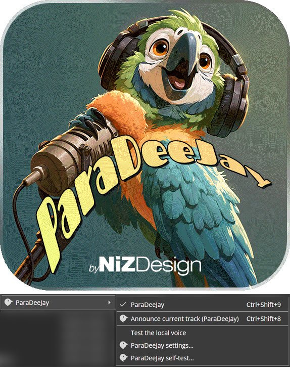

# ParaDeeJay

[](https://github.com/djnizzi/ParaDeeJay/releases/latest)
[](https://github.com/djnizzi/ParaDeeJay/releases)


A MediaMonkey 5 addon that announces the playing track in a **local neural voice**.
No cloud, no API key, no installed Windows voice: it runs [Paradee], an 8M-parameter
text-to-speech model distilled from Kokoro-82M, inside MediaMonkey's own Chromium.

- 8.5 MB int8 ONNX model, four voices (`af_heart`, `bf_isabella`, `am_puck`, `bm_fable`)
- ~12x faster than real time on one wasm thread, so a track title is spoken about
  200 ms after playback starts
- The music ducks under the announcement and returns when the voice stops
- Nothing leaves the machine, and no network access is needed after install

This addon is separate from **Track Announcer** and can be installed alongside it.
If both are enabled they will both speak, so turn off speech in the one you are not using.

## Install

1. Build the package (below) or take `ParaDeeJay.mmip` from a release.
2. MediaMonkey: **Tools > Addons > Add**, choose the `.mmip`, restart.
3. Options: **Tools > Addons > ParaDeeJay > Configure** — choose one of the four
   voices, set speed and volume, and press **Test voice** to hear the voice you
   picked before closing the dialog.

Hotkeys: `Ctrl+Shift+9` toggles announcements, `Ctrl+Shift+8` announces the current
track immediately. Both are also in **Play > ParaDeeJay** and on the toolbar button.

## Settings

The toolbar button and `Ctrl+Shift+9` switch announcements on and off; the button
dims while they are off, the toast that follows (`ParaDeeJay: ON` / `OFF`) confirms
the change, and the addon stays silent while it is off, including after a
MediaMonkey restart. Voice, speed and
volume apply to the next announcement, so press **Test voice** to hear them without
waiting for a track change.

Settings live in MediaMonkey's `persistent.json` under `paraDeeJay_settings`. They
are written as a JSON string, because the host does not hand a stored object back
unchanged, and mirrored into `localStorage` with a revision counter so the main
window and the settings dialog cannot read a stale copy. Pressing OK in the dialog
merges into what is already stored rather than replacing it, so a hand-written
`assetBaseOverride` survives a save.

## Build

```sh
node tools/build-lexicon.js   # only when changing the G2P; needs tools/cmudict.dict
node build.js                 # -> ParaDeeJay.mmip
```

The addon icon is drawn as `paradeejay.png` and `build.js` copies it over
`icon.png` (the file `info.json` names) whenever it is newer, so re-saving the
artwork and re-running the build is enough. 640x640 is the size the build warns
about; the shipped artwork is 574x574 with alpha at 241 KB, already more than
MediaMonkey needs.

The small toolbar and menu glyph is a separate file, `skin/icon/para-deejay.svg`.
MediaMonkey resolves every `icon:` name in the addon to `skin/icon/<name>.svg` and
asserts at startup when it is missing, so changing the addon id or an action's icon
means shipping a matching file there. It uses `class="textColor"` instead of a
fixed fill so the skin colours the glyph.

`node tools/build-lexicon.js` downloads nothing: fetch `cmudict.dict` from
<https://raw.githubusercontent.com/cmusphinx/cmudict/master/cmudict.dict> into
`tools/` first. `build.js` writes the zip itself: PowerShell's `Compress-Archive`
stores backslash entry names, which MediaMonkey extracts as literal `vendor\file`
names instead of a folder.

## How it works

```
track "Midnight City by M83"
  -> engine.js        G2P -> Kokoro/misaki-style IPA -> vocab ids
  -> vendor/*.onnx    Paradee int8, one graph: ids + speed + voice -> 24 kHz float32
  -> Web Audio        one buffer source, volume via a gain node
```

The pieces, all vendored so the addon works offline:

| File | Size | Role |
|---|---|---|
| `vendor/paradee_int8.onnx` | 8.5 MB | the model |
| `vendor/ort.min.js` + `vendor/ort-wasm-simd.wasm` | 0.5 + 10.5 MB | onnxruntime-web 1.17.3 (classic build, no ESM) |
| `vendor/lexicon.tsv.gz` | 0.8 MB | 124,926 CMUdict words mapped to misaki IPA |
| `dictionary.js` | tiny | accent folding, symbol words, name respellings |
| `g2p.js` | small | text normalisation, IPA, token ids |
| `engine.js` | small | lazy load, inference, playback |

**Phonemes matter.** Paradee was trained only on misaki's spelling of phonemes
(`aɪ -> I`, `oʊ -> O`, `tʃ -> ʧ`, `r -> ɹ`). Fed raw eSpeak or CMU output it
mumbles badly, so `tools/build-lexicon.js` converts ARPAbet to misaki's IPA and
`g2p.js` normalises numbers, codes (`M83 -> "em eighty three"`), acronyms and
`feat.`/`&`/`vs.` before lookup. Words missing from the lexicon go through a small
letter-to-sound fallback.

**Names and accents.** `dictionary.js` runs before tokenisation and folds accented
letters, ligatures and typographic punctuation to ASCII, so `RÜFÜS` reaches the
lexicon as `RUFUS`, `Motörhead` as `Motorhead` and `Björk` as `Bjork`. That step is
what fixes names being spelled out: the tokenizer only accepts ASCII words, so an
`Ü` used to be dropped and the leftover `R`, `F` and `S` were each read on their
own — "ar ef es". The same table turns `&`, `@`, `+`, `#`, `%` and `$` into words
instead of silence.

Names that survive folding but are still mispronounced are respelled by a plain
`PHRASES` table in `dictionary.js`:

```js
['rufus du sol', 'rufus doo sol'],
['motorhead', 'motor head'],
['beyonce', 'bee yon say'],
```

The easiest place to add a name is the **Names** list in the settings dialog
(**Tools > Addons > ParaDeeJay > Configure**): one row per name, how it is
written on the left and how it should sound on the right, **Add name** for
another row, `×` to drop one.

```
RÜFÜS            Rufus
RÜFÜS DU SOL     Rufus doo sol
Sigur Rós        Sigur ross
```

These entries live with the other settings rather than in `dictionary.js`, so an
add-on update cannot throw them away, and they are matched before the built-in
table — a dialog entry always wins. The left column is folded like track text, so
`RÜFÜS` and `RUFUS` are the same entry, matching ignores case, respects word
boundaries and tries the longest entry first. Empty and half-filled rows are
dropped on save. The respelling is fed back through the ordinary word lookup, so
it only works if it is spelled the way you want it said.

**Export CSV…** opens a save dialog, starting in MediaMonkey's user folder with
`ParaDeeJay names` filled in, and writes whatever you choose. The file is UTF-8
with a byte-order mark, CRLF line ends and CSV quoting, so Excel shows `RÜFÜS`
and `Rufus` as two cells with the accents intact. It exports what is on screen,
so rows you have added but not saved are included; cancelling does nothing.

**Import CSV…** opens a file picker, starting in the same folder, and adds
whatever is not already in the list, leaving the rows on screen where they are.
Quoted cells, doubled quotes and any of CRLF, LF or CR line ends are understood,
the header and byte-order mark are skipped, and names already present are skipped
case-insensitively, so importing the same file twice changes nothing. It reports
what it did under the buttons, and the imported names are only kept once you
press OK.

For a bulk import, the installed table can also be edited directly:

```
%APPDATA%\MediaMonkey5\scripts\paraDeeJay\dictionary.js
```

Restart MediaMonkey and the next announcement uses it. Editing the copy in this
repository instead means running `node build.js` and reinstalling the `.mmip`,
because the built-in table ships inside the package.

Nothing loads at startup: the first announcement resolves paths, fetches the
runtime and builds the session (~1.5 s), then the session stays warm. `init.js`
also warms it in the background 4 s after the window is ready.

## The one thing that may need attention

MediaMonkey evaluates addon code inside its own window, and it does not document a
"give me a URL for a file in my addon" API. Relative URLs therefore resolve against
MediaMonkey's document, not the addon folder. `platform.js` probes, in order:

1. `assetBaseOverride` from settings (for manual repair)
2. the base remembered from a previous successful run
3. the install path captured by `install.js` (`window.__currentAddonPath`) as `file://`
4. `scripts/paraDeeJay/` relative to the page
5. `paraDeeJay/` relative to the page

The first folder that serves a valid `info.json` wins and is remembered. If none
does, the addon falls back to the system voice (if that setting is on) and
**Play > ParaDeeJay > ParaDeeJay self-test…** prints exactly what failed and why.
To repair manually, set `assetBaseOverride` in `persistent.json` under
`paraDeeJay_settings` to a folder URL ending in `/`.

If a setting looks ignored, run **Play > ParaDeeJay > ParaDeeJay self-test…** (or
the **Self-test** button in the dialog) and read its
`Settings (paraDeeJay_settings)` block: `stored` is the raw value MediaMonkey
returns, `mirror` is the `localStorage` copy, `in use` is what the addon is
actually working from, and `string round-trip` says whether a write survives a
read. `in use` disagreeing with the dialog points at the settings store; agreeing
with it but not changing the voice points at the engine instead.

## Licences

ParaDeeJay itself is MIT licensed, (c) 2026 NiZDesign — see [LICENSE](LICENSE).
That covers the addon's code and settings page. Everything it bundles keeps its
own licence:

- Paradee model and the misaki phoneme table: Apache 2.0, (c) Sahil Mahendrakar,
  distilled from Kokoro-82M by hexgrad. The full text ships in the package as
  `vendor/paradee_LICENSE.txt`.
- onnxruntime-web: MIT, (c) Microsoft.
- CMU Pronouncing Dictionary: BSD-2-clause, (c) Carnegie Mellon University.
- Kokoro vocabulary: Apache 2.0.

[Paradee]: https://github.com/sahilmahendrakar/paradee
